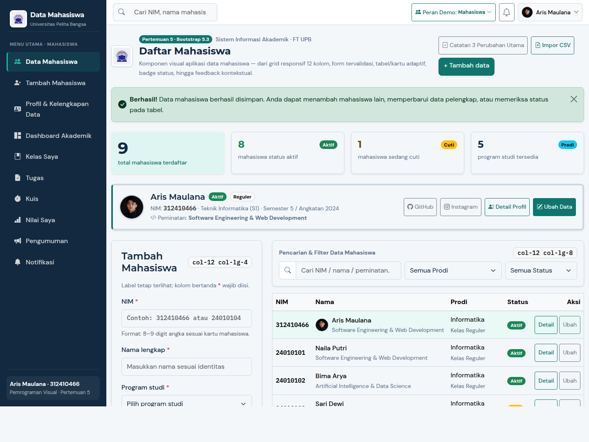
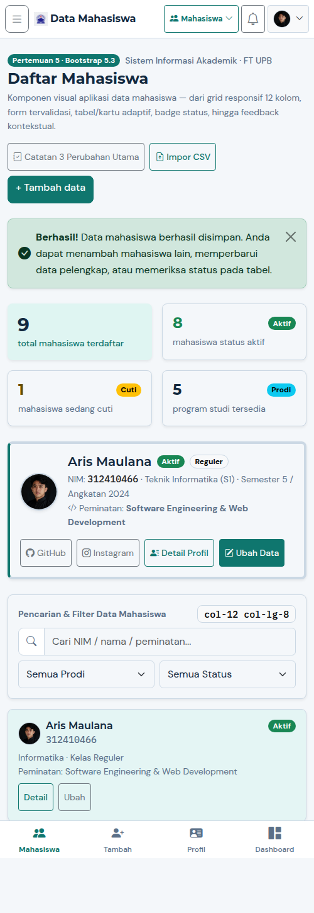

# 🎓 Tugas Praktikum Pemrograman Visual — Pertemuan 5
## Redesign UI/UX Aplikasi Data Mahasiswa dengan Bootstrap 5.3 — Universitas Pelita Bangsa

| Informasi Mahasiswa | Keterangan |
| :--- | :--- |
| **Nama Lengkap** | **Aris Maulana** |
| **NIM** | **312410466** |
| **Fakultas / Program Studi** | Fakultas Teknik (FT) / Teknik Informatika (S1) |
| **Semester / Angkatan** | Semester 5 / Angkatan 2024 |
| **Mata Kuliah** | Pemrograman Visual (`INF301`) — Pertemuan 5 |
| **Topik** | *Rancang UI yang Jelas, Bukan Sekadar Cantik (Grid, Form, Tabel, Badge, Alert & Feedback)* |

---

## 📦 Daftar Deliverables Pertemuan 5

Sesuai instruksi slide **Pertemuan 5 (Halaman 10–13)**, repositori/folder ini memuat seluruh *deliverables* beserta bukti proses audit, redesign, dan pengujian:

1. **Source Code Proyek**: Aplikasi **SvelteKit 2 (Svelte 5) + Bootstrap 5.3** (`src/routes/admin/students/+page.svelte`, `src/routes/admin/students/create/+page.svelte`, `src/routes/admin/students/[id]/edit/+page.svelte`, dan `src/routes/profile/+page.svelte`).
2. **2 Screenshot (Desktop + Mobile)**:
   - Desktop (`≥ 992px` / `1440×1080`): [`screenshots/screenshot-desktop.png`](screenshots/screenshot-desktop.png)
   - Mobile (`< 768px` / `500×1450`): [`screenshots/screenshot-mobile.png`](screenshots/screenshot-mobile.png)
3. **Catatan 3 Perubahan Utama (Audit Proyek Lama vs Redesign Baru)**: Dijelaskan secara rinci pada bagian di bawah ini serta dapat dibuka langsung di dalam aplikasi melalui tombol **"Catatan 3 Perubahan Utama"**.
4. **Tautan Repositori & Berkas ZIP Proyek**:
   - Repositori GitHub: [https://github.com/MasAris1/Tugas-Pemrograman-Visual---Pertemuan-5](https://github.com/MasAris1/Tugas-Pemrograman-Visual---Pertemuan-5)
   - Berkas ZIP Lokal: `Tugas-Pertemuan-5-Aris-Maulana-312410466.zip`

---

## 🔍 Tahap 01 & 02: Audit Proyek Lama & Catatan 3 Perubahan Utama

Perbandingan dilakukan terhadap proyek pertemuan sebelumnya yang berada di `/home/aris-maulana/Downloads/Tugas Pemograman Visual/index.html` (*Web Profil & Sistem Kelengkapan Data Mahasiswa*).

### Ringkasan Perbandingan (*Before vs After*)

| Aspek Penilaian | Proyek Lama (`Tugas Pemograman Visual/index.html`) | Proyek Baru (`Pertemuan 5` — Bootstrap 5.3) |
| :--- | :--- | :--- |
| **Struktur & Responsivitas (30%)** | Hanya menampilkan 1 kartu profil tunggal (*single-record*) dengan Tailwind CDN tema gelap (*Zinc-950*). Belum memiliki layout pengelolaan daftar mahasiswa. | Menggunakan sistem **Grid 12 Kolom Bootstrap 5** (`container-xl`, `row g-4`, `col-12 col-lg-4` untuk Form & `col-12 col-lg-8` untuk Daftar Mahasiswa) + Sidebar Desktop & Bottom Nav Mobile. |
| **Pemilihan Komponen (25%)** | Hanya terdiri dari input teks/select di dalam kartu kaca (*glass-card*) tanpa tabel data, tanpa filter, dan tanpa badge status akademik. | Memadukan **Kartu KPI Ringkasan**, **Tabel Responsif (`≥768px`)**, **Kartu Mahasiswa Mobile (`<768px`)**, **Badge Status (`rounded-pill`)**, **Form Select/Radio**, dan **Alert Konfirmasi**. |
| **Kejelasan & Konsistensi (20%)** | Kontras teks abu-abu (`text-zinc-400`/`500`) di atas latar gelap transparan rawan sulit dibaca; mode baca dan mode edit bertumpuk di tempat yang sama. | Palet **Navy (`#12293F`) + Teal (`#0F766E`)** di atas latar terang (`#F4F7FA`) berstandar **WCAG 2.1 AA**. Label selalu terlihat di atas input dan aksi utama (`btn-primary`) dibedakan tegas dari aksi batal (`btn-outline-secondary`). |
| **Feedback & Validasi (15%)** | Tombol *Simpan Perubahan* langsung menyimpan ke `localStorage` tanpa validasi field wajib/format NIM dan tanpa pesan error dekat input. | Validasi **per-field** (`is-invalid` + `.invalid-feedback` tepat di bawah input NIM, Nama Lengkap, dan Prodi) serta **Alert Sukses kontekstual** yang menjelaskan *apa yang terjadi dan apa langkah berikutnya*. |

---

### Tiga Perubahan Utama (Beserta Alasan & Bukti Implementasi)

#### 1. Perubahan 1 — Dari Tampilan Profil Tunggal Menjadi Grid Responsif 12 Kolom (`col-12 col-lg-4` & `col-12 col-lg-8`) dengan Hierarki Visual Jelas
- **Masalah pada Tampilan Lama (Audit UI/UX #1)**:
  Pada proyek sebelumnya (`index.html`), antarmuka hanya menampilkan kartu profil satu mahasiswa (**Aris Maulana — NIM 312410466**) dengan efek *dark glassmorphism* (`rgba(24, 24, 27, 0.75)`). Pengguna tidak dapat melihat ringkasan jumlah mahasiswa, memindai daftar mahasiswa lain, ataupun menambah data baru sambil tetap melihat daftar yang ada.
- **Solusi Redesign & Alasan Pemilihan Komponen**:
  - Menerapkan aturan praktis **Slide 6 & Slide 9 Pertemuan 5**: memulai dari mobile (`col-12`), lalu memperluas layout pada layar besar menjadi `col-12 col-lg-4` (Formulir Tambah Mahasiswa) dan `col-12 col-lg-8` (Filter + Tabel Daftar Mahasiswa).
  - Menambahkan **4 Kartu Ringkasan KPI** (*Total Mahasiswa Terdaftar*, *Mahasiswa Aktif*, *Mahasiswa Cuti*, *Program Studi*) di bagian atas serta **Kartu Sorotan Mahasiswa Utama (Aris Maulana — 312410466)** lengkap dengan foto profil `/foto-aris.jpg`, logo Universitas Pelita Bangsa, peminatan akademik, dan *Quick Social Badges*.

#### 2. Perubahan 2 — Adaptasi Komponen Data Padat: Tabel Ber-Badge pada Desktop (`≥ 768px`) dan Kartu Mahasiswa pada Mobile (`< 768px`)
- **Masalah pada Tampilan Lama (Audit UI/UX #2)**:
  Proyek lama belum memiliki komponen tabel data maupun penanda visual status mahasiswa (*Aktif*, *Cuti*, *Lulus*, *Nonaktif*). Jika tabel multi-kolom dipaksakan tampil apa adanya di layar ponsel, pengguna harus menggeser layar secara horizontal (*horizontal scrolling*) sehingga menyulitkan pemindaian data.
- **Solusi Redesign & Alasan Pemilihan Komponen**:
  - Pada layar **Desktop & Tablet (`≥ 768px`, `.d-none.d-md-block`)**, data disajikan menggunakan `<table class="table table-hover align-middle">` dengan kolom **NIM** (`font-monospace`), **Nama & Peminatan**, **Prodi & Jenis Kelas**, **Badge Status** (`.badge.rounded-pill.text-bg-success` untuk *Aktif* dan `.text-bg-warning` untuk *Cuti*), serta tombol aksi **Detail / Ubah**.
  - Pada layar **Mobile (`< 768px`, `.d-md-none`)**, tabel otomatis digantikan oleh **Kartu Mahasiswa (`.card`)** vertikal yang menampilkan nama, NIM, badge status di sudut kanan atas, prodi, dan tombol aksi yang nyaman disentuh (tinggi minimal `44px`).

#### 3. Perubahan 3 — Pencegahan Kesalahan Input dengan Validasi Dekat Input (`.invalid-feedback`) & Feedback Kontekstual
- **Masalah pada Tampilan Lama (Audit UI/UX #3)**:
  Pada proyek sebelumnya, formulir tidak menandai kolom wajib secara eksplisit, tidak memvalidasi format NIM/kelengkapan field sebelum disimpan, dan *toast* hanya menampilkan pesan singkat tanpa memandu langkah pengguna selanjutnya.
- **Solusi Redesign & Alasan Pemilihan Komponen**:
  - Mengimplementasikan **Checklist Cepat Form yang Baik (Slide 7 Pertemuan 5)**:
    1. **Tipe input tepat**: `inputmode="numeric"` dengan `maxlength="9"` untuk NIM (mendukung NIM 9 digit UPB `312410466` maupun 8 digit `24010101`), `<select class="form-select">` untuk Program Studi, Jenis Kelas, dan Peminatan agar bebas salah ketik, serta radio button untuk Status Akademik.
    2. **Penanda field wajib jelas**: Label selalu tampil di atas input (`<label class="form-label">`) dilengkapi tanda `*` merah, sedangkan `placeholder` hanya memberi contoh format.
    3. **Validasi dekat dengan input**: Saat form dikirim dengan data tidak valid, fokus otomatis diarahkan ke field pertama yang bermasalah dan pesan `.invalid-feedback` muncul tepat di bawah input tersebut.
    4. **Pemisahan aksi utama & batal**: Tombol **Simpan data** menggunakan `.btn.btn-primary`, sedangkan **Batal** menggunakan `.btn.btn-outline-secondary`.
  - Mengimplementasikan **Feedback Kontekstual (Slide 8 Pertemuan 5)**: Setelah data disimpan, muncul komponen `.alert.alert-success` (`✓ Berhasil! Data mahasiswa ... berhasil disimpan. Anda dapat menambah mahasiswa lain atau memeriksa baris yang disorot di bawah`) sekaligus menyorot baris mahasiswa yang baru disimpan pada tabel (`.row-highlight`).

---

## 💡 Jawaban Pertanyaan Diskusi Pertemuan 5 (Slide 13)

1. **Komponen apa yang paling mengurangi kesalahan input?**
   - Komponen **`<select class="form-select">` (Dropdown Pilihan Terbatas)** untuk memilih *Program Studi*, *Jenis Kelas*, dan *Peminatan* serta **Radio Button (`.form-check-input`)** untuk memilih *Status Akademik* (`Aktif`, `Cuti`, `Lulus`, `Nonaktif`), dikombinasikan dengan input ber-atribut `inputmode="numeric"` dan validasi `.invalid-feedback` pada kolom **NIM**. Pengguna memilih dari opsi resmi yang valid alih-alih mengetik bebas yang rawan *typo* (misalnya salah mengetik `"Teknik Informatka"` atau `"Aktf"`).
2. **Kapan tabel perlu diganti menjadi kartu pada layar kecil?**
   - Tabel perlu diganti menjadi **Kartu (`.card`)** saat lebar layar berada di bawah breakpoint tablet/mobile (**`< 768px`**, menggunakan utilitas Bootstrap `.d-none.d-md-block` pada tabel dan `.d-md-none` pada daftar kartu), terutama ketika tabel memiliki **lebih dari 3–4 kolom data** (NIM, Nama, Prodi, Status, dan tombol Aksi) yang jika dipaksakan pada layar ponsel akan memicu *horizontal scroll*, memotong teks penting, atau memperkecil ukuran tombol di bawah batas sentuh `44×44px`.

---

## 📸 Tahap 03: Bukti Pengujian Visual (Desktop & Mobile)

### 1. Tampilan Desktop (`≥ 992px` — `1440×1080`)
Menampilkan Sidebar navigasi tetap di kiri, kartu KPI ringkasan, kartu profil utama **Aris Maulana (`312410466`)**, serta susunan berdampingan `col-lg-4` (Form Tambah Mahasiswa) dan `col-lg-8` (Tabel Data Mahasiswa ber-badge).



### 2. Tampilan Mobile (`< 768px` — `500×1450`)
Menampilkan bilah atas ringkas dengan tombol menu *Offcanvas*, kartu metrik 2 kolom (`col-6`), transformasi otomatis tabel menjadi **Kartu Mahasiswa Mobile (`d-md-none`)**, formulir yang menumpuk penuh (`col-12`), serta bilah navigasi bawah (*Bottom Navigation*).



---

## 🚀 Cara Menjalankan Proyek

```bash
# 1. Pasang dependensi
bun install

# 2. Jalankan server pengembangan
bun run dev

# 3. Periksa tipe TypeScript & diagnostik Svelte
bun run check

# 4. Bangun untuk produksi
bun run build
```
Buka `http://localhost:5173` pada browser (otomatis mengarahkan ke halaman utama `/admin/students` — **Daftar & Tambah Data Mahasiswa**).
