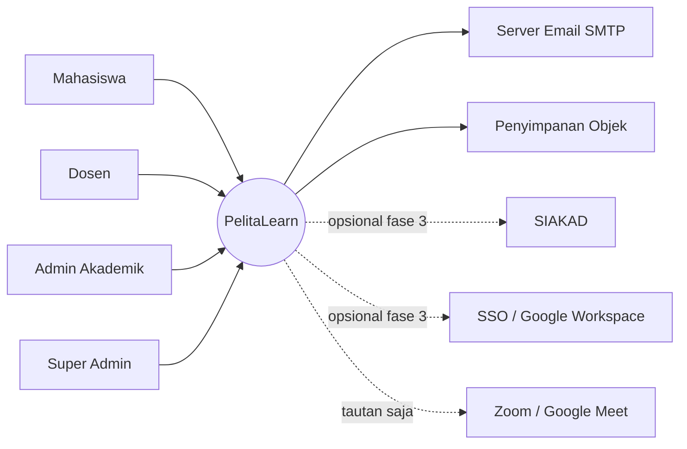
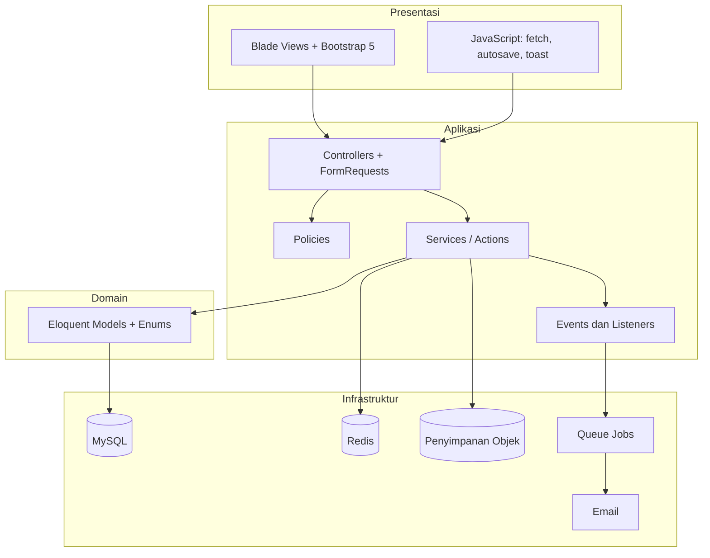
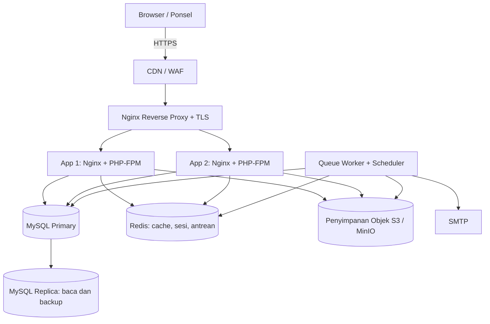
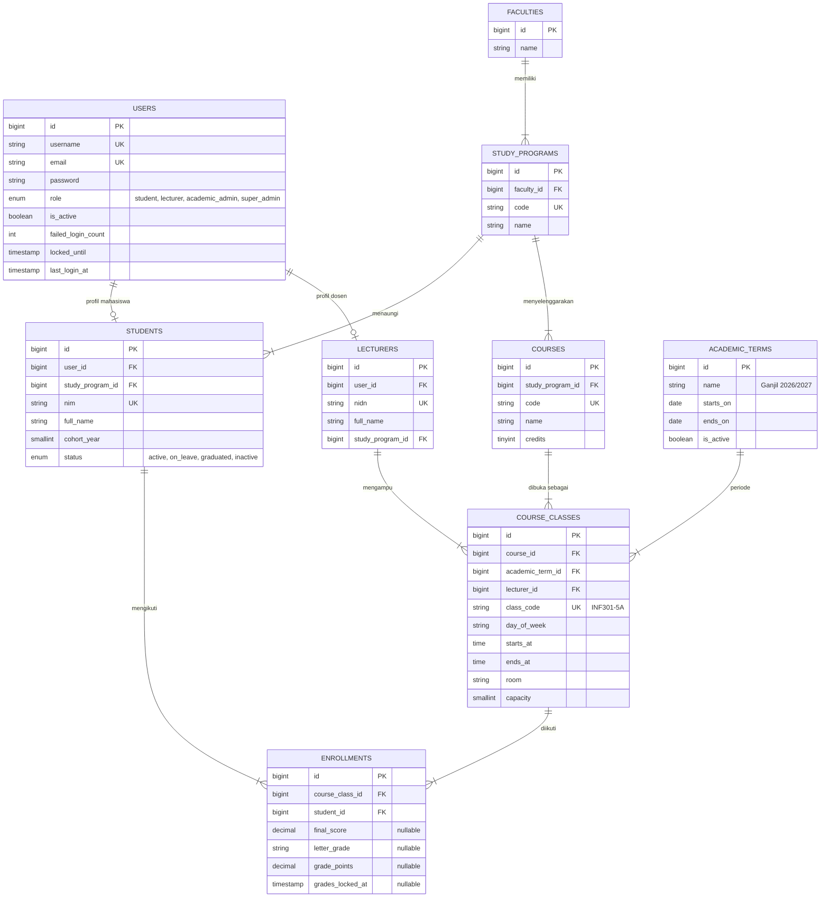
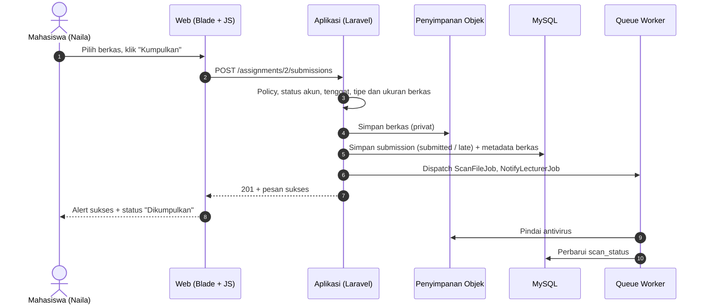
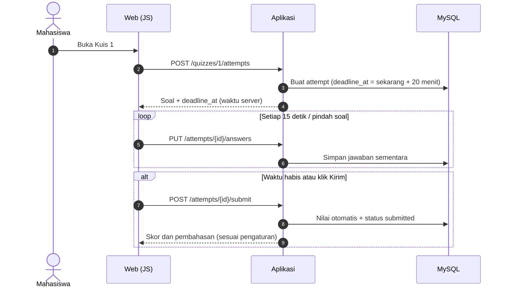

# Arsitektur — LMS Universitas Pelita Bangsa (PelitaLearn)

| | |
|---|---|
| **Versi** | 1.0 (draft untuk ditinjau) |
| **Tanggal** | 18 Oktober 2026 |
| **Dokumen terkait** | [PRD.md](PRD.md) · [desain.md](desain.md) |

> Stack pada dokumen ini adalah **rekomendasi** yang dipilih karena ekosistemnya matang, mudah dicari tenaganya di Indonesia, dan selaras dengan materi UI Bootstrap 5. Bagian yang bisa diganti tanpa mengubah PRD ditandai pada tabel keputusan (§3). Seluruh data contoh adalah **data dummy** dari [PRD.md Lampiran A](PRD.md#lampiran-a--data-dummy).

---

## 1. Tujuan dan Prinsip Arsitektur

| Prinsip | Penerapan |
|---|---|
| **Sederhana dulu** | *Modular monolith*, bukan microservices. Skala target 5.000 akun dan 800 pengguna bersamaan dapat dilayani satu aplikasi yang diskalakan horizontal. |
| **Aman secara bawaan** | Otorisasi berlapis (peran + kepemilikan kelas), berkas privat, audit log, validasi di server. |
| **Tahan lonjakan** | Pekerjaan berat (pindai berkas, email, rekap) lewat antrean; autosave kuis; cache untuk halaman baca-berat. |
| **Mudah diubah** | Batas modul yang jelas, kebijakan (skala nilai, penalti, batas unggah) berada di konfigurasi, bukan di kode. |
| **Dapat diamati** | Log terstruktur, pelacakan galat, health check. |
| **Aksesibel dan responsif** | Server-rendered HTML dengan Bootstrap 5; JavaScript hanya sebagai peningkatan progresif. |

## 2. Konteks Sistem



## 3. Keputusan Teknologi

| ID | Keputusan | Pilihan | Alasan | Alternatif |
|---|---|---|---|---|
| ADR-01 | Gaya arsitektur | Modular monolith | Tim kecil, satu deploy, transaksi konsisten untuk nilai | Microservices (berlebihan untuk skala ini) |
| ADR-02 | Bahasa dan framework | PHP 8.3 + Laravel 11 | Auth, policy, queue, scheduler, migrasi sudah tersedia; tenaga mudah dicari | Node + NestJS, Django |
| ADR-03 | Basis data | MySQL 8 (InnoDB) | Relasional, cocok untuk data akademik berstruktur | PostgreSQL |
| ADR-04 | Cache, sesi, antrean | Redis 7 | Satu komponen untuk tiga kebutuhan | Database queue (lebih lambat) |
| ADR-05 | Antarmuka | Blade (server-rendered) + Bootstrap 5.3 + JavaScript biasa/Alpine.js | Cepat dimuat, aksesibel, selaras materi kuliah | SPA React/Vue (lebih berat) |
| ADR-06 | Penyimpanan berkas | S3-compatible (MinIO on-prem atau S3) lewat Flysystem; bucket privat + URL bertanda tangan | Berkas besar tidak membebani server aplikasi | Disk lokal (sulit diskalakan) |
| ADR-07 | Autentikasi | Sesi berbasis cookie untuk web; Laravel Sanctum untuk token API | Aman bagi web; siap untuk klien mobile | JWT |
| ADR-08 | Otorisasi | Kolom `role` + Laravel Policy per sumber daya | Cukup untuk 4 peran; tanpa dependensi tambahan | Spatie Permission (bila peran makin rumit) |
| ADR-09 | Deployment | Docker; Nginx + PHP-FPM; Compose untuk dev, VM/orkestrasi untuk produksi | Lingkungan seragam | Server tanpa kontainer |
| ADR-10 | Pengujian | Pest (unit/feature), Playwright (end-to-end), k6 (beban) | Cepat dan ekspresif | PHPUnit murni |

## 4. Arsitektur Logis



Alur umum satu permintaan: `Route → Middleware (auth, status mahasiswa, peran) → FormRequest (validasi) → Controller → Policy (otorisasi) → Service/Action → Model → Respons (Blade atau JSON)`.

### 4.1 Modul

| Modul | Tanggung jawab | Padanan di PRD |
|---|---|---|
| `Auth` | Login, reset kata sandi, 2FA, penguncian akun, profil | FR-AUTH |
| `Academic` | Fakultas, prodi, periode, mata kuliah, kelas, enrolment, mahasiswa/dosen, impor CSV | FR-AKD |
| `Learning` | Materi, status terbit, progres | FR-MAT |
| `Assignment` | Tugas, pengumpulan, versi, penilaian, penalti | FR-TGS |
| `Quiz` | Bank soal, kuis, percobaan, autosave, penilaian otomatis | FR-KUI |
| `Forum` | Thread, balasan, moderasi | FR-FRM |
| `Attendance` | Sesi presensi, check-in, rekap | FR-PRS |
| `Grading` | Komponen, bobot, nilai akhir, huruf mutu, finalisasi, ekspor | FR-NIL |
| `Communication` | Pengumuman, notifikasi, kalender | FR-PGM, FR-NTF, FR-KAL |
| `Reporting` | Laporan CSV/PDF, audit log | FR-LAP |

Aturan antarmodul: modul hanya memanggil modul lain lewat *Service* atau *Event* publiknya, tidak lewat model internal. Contoh: `Assignment` memancarkan event `SubmissionGraded`; `Grading` mendengarkan untuk menghitung ulang komponen Tugas.

### 4.2 Struktur Direktori

```text
pelitalearn/
├── app/
│   ├── Modules/
│   │   ├── Auth/            # Controllers, Requests, Services
│   │   ├── Academic/
│   │   ├── Learning/
│   │   ├── Assignment/
│   │   ├── Quiz/
│   │   ├── Forum/
│   │   ├── Attendance/
│   │   ├── Grading/
│   │   ├── Communication/
│   │   └── Reporting/
│   ├── Models/              # Eloquent model bersama
│   ├── Policies/            # Satu policy per sumber daya
│   ├── Enums/               # Role, StudentStatus, SubmissionStatus, dll.
│   ├── Jobs/                # ScanFileJob, SendNotificationJob, RecalculateGradeJob
│   └── Support/             # Helper, trait, formatter tanggal WIB
├── config/
│   └── grading.php          # Skala huruf mutu, penalti, batas unggah
├── database/
│   ├── migrations/
│   ├── factories/           # Faker locale id_ID
│   └── seeders/             # DemoSeeder mengikuti PRD Lampiran A
├── resources/
│   ├── views/               # layouts/, components/, per modul
│   ├── scss/                # custom.scss (override variabel Bootstrap)
│   └── js/
├── routes/                  # web.php, api.php
├── tests/                   # Unit/, Feature/, Browser/
├── docker/                  # Dockerfile, nginx.conf, compose
└── .github/workflows/       # ci.yml, deploy.yml
```

## 5. Arsitektur Deployment



| Lingkungan | Tujuan | Catatan |
|---|---|---|
| `local` | Pengembangan | Docker Compose: app, MySQL, Redis, MinIO, Mailpit |
| `staging` | Uji penerimaan, demo | Data dummy; akun demo diaktifkan |
| `production` | Pengguna nyata | Akun demo **dinonaktifkan**; seeder demo tidak dijalankan |

**Ukuran awal (perkiraan, divalidasi dengan uji beban):** 2 node aplikasi (4 vCPU, 8 GB), 1 node MySQL (4 vCPU, 16 GB) + replika, Redis 2 GB, penyimpanan objek 500 GB. Scheduler berjalan di satu node saja (`php artisan schedule:work` di bawah Supervisor, dengan `onOneServer()`).

## 6. Model Data

### 6.1 ERD — Identitas dan Akademik



### 6.2 ERD — Pembelajaran dan Penilaian

Seluruh aktivitas mahasiswa terikat ke `enrollment_id` (bukan langsung `student_id`) sehingga otorisasi dan rekap selalu per kelas.

```mermaid
erDiagram
    COURSE_CLASSES ||--|{ MATERIALS : berisi
    COURSE_CLASSES ||--|{ ASSIGNMENTS : berisi
    COURSE_CLASSES ||--|{ QUIZZES : berisi
    COURSE_CLASSES ||--|{ ATTENDANCE_SESSIONS : "sesi presensi"
    COURSE_CLASSES ||--|{ GRADE_COMPONENTS : "komponen nilai"
    COURSE_CLASSES ||--|{ DISCUSSION_THREADS : forum
    COURSE_CLASSES ||--o{ ANNOUNCEMENTS : "pengumuman kelas"
    ASSIGNMENTS ||--|{ SUBMISSIONS : dikumpulkan
    ENROLLMENTS ||--|{ SUBMISSIONS : oleh
    QUIZZES ||--|{ QUIZ_QUESTIONS : memiliki
    QUIZZES ||--|{ QUIZ_ATTEMPTS : dikerjakan
    ENROLLMENTS ||--|{ QUIZ_ATTEMPTS : oleh
    ATTENDANCE_SESSIONS ||--|{ ATTENDANCE_RECORDS : mencatat
    ENROLLMENTS ||--|{ ATTENDANCE_RECORDS : oleh
    GRADE_COMPONENTS ||--|{ GRADE_ENTRIES : bernilai
    ENROLLMENTS ||--|{ GRADE_ENTRIES : oleh
    DISCUSSION_THREADS ||--|{ DISCUSSION_POSTS : balasan

    MATERIALS {
        bigint id PK
        bigint course_class_id FK
        smallint meeting_no
        string title
        enum type "file, link"
        enum status "draft, published, scheduled"
        timestamp publish_at
    }
    ASSIGNMENTS {
        bigint id PK
        bigint course_class_id FK
        string title
        text instructions
        timestamp due_at
        decimal max_score
        enum submission_type "file, text, link"
        enum late_policy "reject, penalty"
        enum status "draft, published, closed"
        timestamp publish_at
    }
    SUBMISSIONS {
        bigint id PK
        bigint assignment_id FK
        bigint enrollment_id FK
        enum status "submitted, late, graded, revision"
        timestamp submitted_at
        decimal score "nullable"
        decimal penalty_applied
        text feedback
        tinyint version
    }
    QUIZZES {
        bigint id PK
        bigint course_class_id FK
        string title
        timestamp opens_at
        timestamp closes_at
        smallint duration_minutes
        tinyint max_attempts
        boolean shuffle_questions
    }
    QUIZ_QUESTIONS {
        bigint id PK
        bigint quiz_id FK
        enum type "mcq, true_false, short_answer"
        text body
        json options
        json answer_key
        decimal points
    }
    QUIZ_ATTEMPTS {
        bigint id PK
        bigint quiz_id FK
        bigint enrollment_id FK
        enum status "in_progress, submitted, expired"
        timestamp started_at
        timestamp deadline_at
        json answers
        decimal score "nullable"
    }
    ATTENDANCE_SESSIONS {
        bigint id PK
        bigint course_class_id FK
        smallint meeting_no
        date session_date
        string code
        timestamp opens_at
        timestamp closes_at
    }
    ATTENDANCE_RECORDS {
        bigint id PK
        bigint attendance_session_id FK
        bigint enrollment_id FK
        enum status "present, excused, sick, absent"
        timestamp checked_in_at
        string note
    }
    GRADE_COMPONENTS {
        bigint id PK
        bigint course_class_id FK
        string name
        enum source "attendance, assignment, quiz, manual"
        decimal weight "total per kelas = 100"
    }
    GRADE_ENTRIES {
        bigint id PK
        bigint grade_component_id FK
        bigint enrollment_id FK
        decimal score
    }
    DISCUSSION_THREADS {
        bigint id PK
        bigint course_class_id FK
        bigint author_user_id FK
        string title
        boolean is_pinned
        boolean is_closed
    }
    DISCUSSION_POSTS {
        bigint id PK
        bigint thread_id FK
        bigint author_user_id FK
        text body
    }
    ANNOUNCEMENTS {
        bigint id PK
        bigint course_class_id FK "null = global"
        bigint author_user_id FK
        string title
        text body
        timestamp published_at
    }
```



### 6.3 Tabel Pendukung

| Tabel | Fungsi | Kolom kunci |
|---|---|---|
| `files` | Metadata berkas (polimorfik: materi, tugas, pengumpulan) | `disk`, `path`, `original_name`, `mime`, `size`, `sha256`, `scan_status` (`pending`/`clean`/`infected`), `owner_type`, `owner_id` |
| `notifications` | Notifikasi dalam aplikasi | `user_id`, `type`, `data` (JSON), `read_at` |
| `audit_logs` | Jejak aktivitas sensitif | `user_id`, `action`, `subject_type`, `subject_id`, `old_values`, `new_values`, `reason`, `ip`, `created_at` |
| `material_progress` | Penanda materi selesai | `material_id`, `enrollment_id`, `completed_at` |
| `app_settings` | Konfigurasi dinamis (skala nilai, penalti, batas unggah) | `key`, `value` (JSON) |

### 6.4 Batasan dan Indeks Penting

| Tabel | Batasan / indeks | Alasan |
|---|---|---|
| `enrollments` | `UNIQUE (course_class_id, student_id)` | Satu mahasiswa tidak terdaftar ganda |
| `submissions` | `UNIQUE (assignment_id, enrollment_id)` + indeks `(assignment_id, status)` | Satu baris aktif per tugas; daftar penilaian cepat |
| `attendance_records` | `UNIQUE (attendance_session_id, enrollment_id)` | Mencegah presensi ganda |
| `grade_entries` | `UNIQUE (grade_component_id, enrollment_id)` | Satu nilai per komponen |
| `quiz_attempts` | Indeks `(quiz_id, enrollment_id, status)` | Cek batas percobaan |
| `course_classes` | `UNIQUE (class_code)`, indeks `(academic_term_id, lecturer_id)` | Dashboard dosen |
| `notifications` | Indeks `(user_id, read_at)` | Hitungan belum dibaca |
| Semua tabel akademik | `deleted_at` (soft delete) | BR-13 |

Aturan bobot (BR-04) divalidasi di aplikasi **dan** diperiksa saat finalisasi nilai. Semua waktu disimpan UTC dan ditampilkan dalam Asia/Jakarta (BR-14).

## 7. Perhitungan Nilai

| Sumber komponen | Cara hitung |
|---|---|
| `attendance` | (hadir + izin/sakit terverifikasi) ÷ total sesi × 100 |
| `assignment` | Rata-rata nilai semua tugas kelas setelah penalti keterlambatan; tugas belum dikumpulkan dihitung 0 setelah tenggat |
| `quiz` | Rata-rata nilai kuis (percobaan terbaik atau terakhir, sesuai konfigurasi) |
| `manual` | Dimasukkan dosen (UTS, UAS) atau diimpor CSV |

Nilai akhir = Σ (nilai komponen × bobot ÷ 100), dibulatkan 2 desimal; huruf mutu dari `config/grading.php`.

```php
// app/Modules/Grading/Services/GradeCalculator.php (ringkas)
public function finalScore(Enrollment $enrollment): float
{
    return round(
        $enrollment->gradeEntries
            ->sum(fn ($entry) => $entry->score * $entry->component->weight / 100),
        2
    );
}

public function letter(float $score): array
{
    foreach (config('grading.scale') as $band) {          // diurutkan dari tertinggi
        if ($score >= $band['min']) {
            return [$band['letter'], $band['points']];     // contoh: ['A', 4.00]
        }
    }
    return ['E', 0.00];
}
```

Contoh uji dari data dummy: Naila Putri (INF301-5A) dengan nilai 100, 90, 85, 88, 92 dan bobot 10/30/10/25/25 menghasilkan **90,50 → A** (PRD AC-05).

Penghitungan ulang berjalan lewat job `RecalculateGradeJob` yang dipicu event `SubmissionGraded`, `QuizAttemptSubmitted`, `AttendanceRecorded`, atau input nilai manual. Setelah `grades_locked_at` terisi, job tidak mengubah nilai.

## 8. Antarmuka: Rute Web dan API

### 8.1 Rute Web (server-rendered)

```php
// routes/web.php (ringkas)
Route::middleware('guest')->group(function () {
    Route::get('/login', ...);            // S01
    Route::get('/forgot-password', ...);  // S02
});

Route::middleware(['auth', 'account.active'])->group(function () {
    Route::get('/dashboard', DashboardController::class);                 // S03 / S09
    Route::get('/classes', ...);                                          // S04
    Route::get('/classes/{class}', ...);                                  // S05
    Route::get('/classes/{class}/assignments/{assignment}', ...);         // S06
    Route::get('/quizzes/{quiz}/attempt', ...);                           // S07
    Route::get('/grades', ...);                                           // S08
    Route::get('/announcements', ...);                                    // S17
    Route::get('/notifications', ...);                                    // S18
    Route::get('/profile', ...);                                          // S19

    Route::prefix('lecturer')->middleware('role:lecturer')->group(function () {
        // S10 konten, S11 penilaian, S12 presensi, S13 bobot dan rekap
    });

    Route::prefix('admin')->middleware('role:academic_admin,super_admin')->group(function () {
        Route::resource('students', ...);   // S14, S15
        Route::resource('classes', ...);    // S16
        Route::get('reports', ...);         // S20
    });
});
```

Middleware `account.active` menegakkan BR-02: mahasiswa `inactive` ditolak login; `on_leave` hanya boleh mengakses `/profile` dan `/grades` (riwayat).

### 8.2 API JSON (`/api/v1`)

Dipakai oleh JavaScript halaman (autosave, presensi, notifikasi) dan klien mobile di masa depan. Autentikasi: sesi web (cookie + CSRF) atau token Sanctum.

| Metode | Endpoint | Peran | Fungsi |
|---|---|---|---|
| POST | `/auth/login` | Publik | Masuk (token untuk klien non-browser) |
| POST | `/auth/logout` | Semua | Keluar |
| GET | `/me` | Semua | Profil dan peran |
| GET | `/dashboard` | Semua | Ringkasan sesuai peran |
| GET | `/classes` | Mahasiswa, dosen | Kelas milik pengguna |
| GET | `/classes/{id}` | Anggota kelas | Detail kelas |
| GET | `/classes/{id}/materials` | Anggota kelas | Daftar materi |
| POST | `/classes/{id}/materials` | Dosen pengampu | Unggah materi |
| POST | `/materials/{id}/complete` | Mahasiswa | Tandai selesai |
| GET | `/classes/{id}/assignments` | Anggota kelas | Daftar tugas |
| POST | `/classes/{id}/assignments` | Dosen pengampu | Buat tugas |
| POST | `/assignments/{id}/submissions` | Mahasiswa | Kumpulkan tugas |
| PATCH | `/submissions/{id}/grade` | Dosen pengampu | Nilai dan umpan balik |
| POST | `/quizzes/{id}/attempts` | Mahasiswa | Mulai percobaan |
| PUT | `/attempts/{id}/answers` | Pemilik percobaan | Autosave jawaban |
| POST | `/attempts/{id}/submit` | Pemilik percobaan | Kirim kuis |
| POST | `/classes/{id}/attendance-sessions` | Dosen pengampu | Buka sesi presensi |
| POST | `/attendance-sessions/{id}/check-in` | Mahasiswa | Presensi dengan kode |
| GET | `/classes/{id}/grades` | Dosen (semua), mahasiswa (milik sendiri) | Rekap nilai |
| PUT | `/classes/{id}/grade-components` | Dosen pengampu | Atur bobot |
| POST | `/classes/{id}/grades/finalize` | Dosen pengampu | Kunci nilai |
| GET | `/notifications` | Semua | Daftar notifikasi |
| POST | `/notifications/read` | Semua | Tandai dibaca |
| GET/POST/PUT | `/admin/students` | Admin | Kelola mahasiswa |
| POST | `/admin/students/import` | Admin | Impor CSV (pratinjau lalu komit) |
| POST | `/admin/enrollments/import` | Admin | Impor enrolment |
| GET | `/admin/audit-logs` | Super admin | Audit log |

**Konvensi:** JSON `snake_case`; koleksi dipaginasi 20 per halaman dengan `meta`; waktu ISO 8601 dengan offset (`2026-10-25T23:59:00+07:00`); galat validasi memakai HTTP 422.

**Contoh — mengumpulkan tugas** (`multipart/form-data`)

```http
POST /api/v1/assignments/2/submissions
Content-Type: multipart/form-data

file=@audit-uiux-naila.pdf
link=https://github.com/example/audit-uiux
```

```json
{
  "data": {
    "id": 17,
    "assignment_id": 2,
    "status": "submitted",
    "submitted_at": "2026-10-17T20:14:00+07:00",
    "version": 1,
    "file": { "name": "audit-uiux-naila.pdf", "size": 4194304, "scan_status": "pending" }
  },
  "message": "Tugas berhasil dikumpulkan pada 17 Oktober 2026 pukul 20.14 WIB."
}
```

**Contoh — galat validasi (422)**

```json
{
  "message": "Berkas tidak dapat diterima.",
  "errors": {
    "file": ["Ukuran berkas maksimal 20 MB. Kompres berkas lalu coba lagi."]
  }
}
```

**Contoh — presensi (`POST /attendance-sessions/6/check-in`)**

```json
{ "code": "PV-7X4K" }
```

Respons sukses 200: `{ "data": { "status": "present", "checked_in_at": "2026-10-19T08:07:00+07:00" } }`. Kode salah atau kedaluwarsa: 422 dengan pesan yang menjelaskan apa yang terjadi dan langkah berikutnya.

**Pembatasan laju:** `login` 5/menit per IP+akun (lalu kunci akun sesuai FR-AUTH-05), API umum 120/menit per pengguna, `check-in` 10/menit per pengguna.

## 9. Autentikasi dan Otorisasi

### 9.1 Alur Autentikasi

1. Login dengan username (NIM/NIDN), email, atau `superadmin`, plus kata sandi.
2. Kata sandi disimpan dengan Argon2id (atau bcrypt cost ≥ 12). Kebijakan: minimal 10 karakter, tidak ada dalam daftar kata sandi umum.
3. Setelah 5 kegagalan, `locked_until = now + 15 menit`.
4. Sesi disimpan di Redis, ID sesi diregenerasi saat login, kedaluwarsa 30 menit tidak aktif.
5. Admin wajib TOTP 2FA (Fase 2).

### 9.2 Matriks Otorisasi (RBAC + kepemilikan)

`C` buat, `R` baca, `U` ubah, `D` hapus. "Milik" = hanya data milik sendiri; "Kelas" = hanya kelas yang diikuti/diampu.

| Sumber daya | Mahasiswa | Dosen | Admin Akademik | Super Admin |
|---|---|---|---|---|
| Fakultas, prodi, periode, mata kuliah | R | R | CRUD | CRUD |
| Kelas | R (Kelas) | R (Kelas), U jadwal tidak boleh | CRUD | CRUD |
| Enrolment | R (Milik) | R (Kelas) | CRUD | CRUD |
| Mahasiswa dan dosen | R profil sendiri | R mahasiswa Kelas | CRUD | CRUD |
| Materi | R (Kelas) | CRUD (Kelas) | R | R |
| Tugas | R (Kelas) | CRUD (Kelas) | R | R |
| Pengumpulan tugas | CRU (Milik, sebelum tenggat) | R, U nilai (Kelas) | R | R |
| Kuis dan soal | R, kerjakan (Kelas) | CRUD (Kelas) | R | R |
| Presensi | Check-in, R (Milik) | CRU (Kelas) | R | R |
| Komponen dan nilai | R (Milik) | CRU (Kelas), kunci | U terkunci + alasan | U terkunci + alasan |
| Forum | CR (Kelas) | CRUD + moderasi (Kelas) | R | RD |
| Pengumuman | R | CRUD (Kelas) | CRUD global | CRUD |
| Laporan | — | R (Kelas) | R | R |
| Audit log, konfigurasi, akun | — | — | R audit | CRUD |

Penegakan: *Policy* per sumber daya (contoh `AssignmentPolicy::view`, `SubmissionPolicy::update`) dan *query scope* yang selalu membatasi data ke kelas pengguna sehingga tidak ada celah IDOR.

## 10. Alur Kunci

### 10.1 Pengumpulan Tugas



### 10.2 Kuis dengan Autosave



Penghitung waktu di klien hanya tampilan; batas sebenarnya `deadline_at` di server. Bila koneksi putus lalu pulih, klien menyinkronkan sisa waktu dari respons server.

### 10.3 Finalisasi Nilai

1. Dosen membuka halaman Bobot dan Rekap (S13); sistem memeriksa total bobot = 100% dan semua komponen manual terisi.
2. Dosen menekan "Finalisasi"; dialog konfirmasi menjelaskan bahwa nilai akan terkunci.
3. Sistem mengisi `grades_locked_at`, menyimpan `final_score`, `letter_grade`, `grade_points`, dan menulis audit log.
4. Mahasiswa menerima notifikasi "Nilai akhir tersedia".
5. Koreksi berikutnya hanya oleh admin akademik: wajib isi alasan, dicatat di `audit_logs`.

## 11. Keamanan

| Ancaman (OWASP) | Mitigasi |
|---|---|
| Broken access control / IDOR | Policy + query scope per kelas; uji otomatis "akses silang kelas" |
| Injeksi SQL | Eloquent/query builder berparameter; tanpa SQL mentah dari input |
| XSS | Escape Blade bawaan; sanitasi HTML untuk konten forum/pengumuman (allow-list); CSP ketat |
| CSRF | Token CSRF pada semua permintaan yang mengubah data; cookie `SameSite=Lax`, `Secure`, `HttpOnly` |
| Autentikasi lemah | Argon2id, pembatasan laju, penguncian akun, 2FA admin, regenerasi sesi |
| Unggahan berbahaya | Allow-list MIME dan ekstensi, verifikasi isi berkas, nama acak, bucket privat, pindai ClamAV, tidak pernah dieksekusi, unduhan lewat URL bertanda tangan berumur pendek |
| Kebocoran data | Respons hanya memuat kolom yang diperlukan; TLS 1.2+; enkripsi disk dan cadangan; `.env` tidak dikomit |
| Konfigurasi salah | Header keamanan (HSTS, X-Content-Type-Options, Referrer-Policy), debug mati di produksi, dependensi dipindai (`composer audit`, Dependabot) |
| Kurangnya jejak | `audit_logs` untuk login, perubahan nilai/status, impor, dan konfigurasi |

**Privasi (UU No. 27 Tahun 2022 tentang Pelindungan Data Pribadi):** kumpulkan hanya data yang diperlukan, batasi akses menurut peran, siapkan prosedur permintaan akses/koreksi data oleh subjek data, tetapkan masa retensi (usulan: nilai permanen, berkas pengumpulan 5 tahun, log aplikasi 12 bulan). Perlu ditinjau oleh bagian hukum kampus.

**Konfigurasi lingkungan (contoh `.env`):**

```ini
APP_ENV=production
APP_TIMEZONE=Asia/Jakarta
APP_LOCALE=id
SESSION_DRIVER=redis
SESSION_LIFETIME=30
CACHE_STORE=redis
QUEUE_CONNECTION=redis
FILESYSTEM_DISK=s3
UPLOAD_MAX_ASSIGNMENT_MB=20
UPLOAD_MAX_MATERIAL_MB=100
LOGIN_MAX_ATTEMPTS=5
LOGIN_LOCK_MINUTES=15
```

## 12. Performa dan Skalabilitas

| Area | Strategi |
|---|---|
| Basis data | Indeks sesuai §6.4; `Model::preventLazyLoading()` di non-produksi untuk mencegah N+1; paginasi 20 baris |
| Cache | Redis: dashboard 60 detik, daftar kelas, konfigurasi; invalidasi lewat event |
| Antrean | Pindai berkas, email, notifikasi, hitung ulang nilai, impor CSV besar |
| Berkas | Unggah materi besar langsung ke penyimpanan objek (presigned URL); video lewat tautan |
| Aset statis | Vite build dengan hash; CDN; font di-host sendiri dengan `font-display: swap` |
| Kuis puncak | Autosave ringan (satu baris JSON per percobaan), tanpa join berat; uji beban 800 pengguna bersamaan |
| Skala horizontal | Aplikasi *stateless* (sesi dan cache di Redis, berkas di objek); tambah node di belakang load balancer |

Target: respons server P95 ≤ 500 ms (non-unggah), LCP P75 ≤ 2,5 s di 4G.

## 13. Observabilitas dan Operasional

| Kebutuhan | Solusi |
|---|---|
| Log | JSON terstruktur ke stdout, dikumpulkan terpusat; ID korelasi per permintaan |
| Galat | Sentry (atau setara) untuk backend dan JS |
| Kesehatan | Endpoint `/up` (basis data, Redis, penyimpanan objek, antrean); dipantau uptime monitor |
| Metrik | Waktu respons, antrean tertunda, tingkat galat 5xx, login gagal |
| Peringatan | Antrean tertunda > 500, galat 5xx > 2% per 5 menit, disk > 80% |
| Cadangan | Dump MySQL harian (simpan 7 harian + 4 mingguan), versi objek diaktifkan, uji pemulihan tiap kuartal (RPO ≤ 24 jam, RTO ≤ 4 jam) |

## 14. Pengujian dan CI/CD

| Jenis | Alat | Cakupan |
|---|---|---|
| Unit | Pest | `GradeCalculator`, penalti keterlambatan, aturan bobot |
| Fitur/Integrasi | Pest + basis data uji | Policy, alur tugas, presensi, kuis, impor CSV |
| End-to-end | Playwright | Login, kumpulkan tugas, presensi, finalisasi nilai pada lebar 360, 768, 1366 px |
| Aksesibilitas | axe-core + uji manual keyboard | Halaman utama, WCAG 2.1 AA |
| Keamanan | `composer audit`, pindai kontainer, uji akses silang | Tiap rilis |
| Beban | k6 | Skenario "hari kuis": 800 pengguna, login → buka kuis → autosave → kirim |

**Pipeline CI/CD (GitHub Actions):**

1. Pull request: Pint (gaya kode), Larastan level 6, Pest, build aset.
2. Merge ke `main`: bangun image Docker, jalankan migrasi di staging, deploy otomatis ke **staging**, jalankan uji E2E.
3. Rilis ke **production**: persetujuan manual, migrasi bersifat *backward-compatible*, deploy bergulir (*rolling*), health check, rollback ke image sebelumnya bila gagal.

Strategi cabang: *trunk-based* dengan cabang fitur pendek; *feature flag* untuk fitur Fase 2.

## 15. Data Dummy dan Seeding

Seeder demo mengikuti [PRD Lampiran A](PRD.md#lampiran-a--data-dummy) agar dokumen, basis data, dan mockup selalu sama.

```bash
php artisan migrate:fresh --seed --seeder=DemoSeeder   # hanya local / staging
```

```php
// database/seeders/DemoSeeder.php
class DemoSeeder extends Seeder
{
    public function run(): void
    {
        abort_if(app()->environment('production'), 403, 'Seeder demo dilarang di produksi.');

        $this->call([
            FacultySeeder::class,        // A.1
            StudyProgramSeeder::class,   // A.1
            AcademicTermSeeder::class,   // Ganjil 2026/2027
            UserSeeder::class,           // A.2 akun demo, A.3 dosen, A.4 mahasiswa (termasuk Sari Dewi: on_leave)
            CourseSeeder::class,         // A.5
            CourseClassSeeder::class,    // A.5
            EnrollmentSeeder::class,     // A.6
            LearningContentSeeder::class,// A.7 materi, A.8 tugas dan kuis
            AttendanceDemoSeeder::class, // A.8 presensi P1–P5
            GradeDemoSeeder::class,      // A.9 komponen, bobot, simulasi nilai
            CommunicationSeeder::class,  // A.10 pengumuman, A.11 forum
        ]);
    }
}
```

| Seeder | Sumber data | Catatan |
|---|---|---|
| `UserSeeder` | A.2–A.4 | Kata sandi demo `Demo#2026`; flag `is_demo = true` agar mudah dibersihkan |
| `GradeDemoSeeder` | A.9 | Menghasilkan simulasi 90,50 / 83,40 / 74,00 / 94,00 untuk uji `GradeCalculator` |
| Factory (`id_ID`) | Faker | Untuk data massal uji beban (mis. 5.000 mahasiswa) tanpa memakai nama nyata |

## 16. Integrasi Masa Depan

| Integrasi | Pendekatan | Fase |
|---|---|---|
| SIAKAD | Ekspor/impor CSV (Fase 1); API terjadwal dan pemetaan NIM/kode kelas (Fase 3) | 1 → 3 |
| SSO | OIDC/SAML lewat Laravel Socialite/provider; pemetaan peran dari klaim | 3 |
| Email | SMTP institusi atau layanan email transaksional; templat berbahasa Indonesia | 2 |
| Video conference | Kolom tautan pada kelas dan pertemuan | 1 |
| PWA | Service worker, cache aset, notifikasi web push | 3 |

## 17. Risiko Teknis dan Mitigasi

| Risiko | Mitigasi |
|---|---|
| Lonjakan beban saat kuis serentak | Autosave ringan, antrean, uji beban k6 sebelum UTS, cadangan kapasitas node |
| Berkas besar membebani server | Presigned upload, batas ukuran, video lewat tautan |
| Kesalahan hitung nilai | Satu *service* terpusat, uji unit dengan data dummy A.9, penguncian dan audit |
| Ketergantungan pada satu vendor penyimpanan | Flysystem memisahkan aplikasi dari penyedia (S3/MinIO/lokal) |
| Pergeseran skop modul | Batas modul + event; fitur Fase 2/3 di balik *feature flag* |
